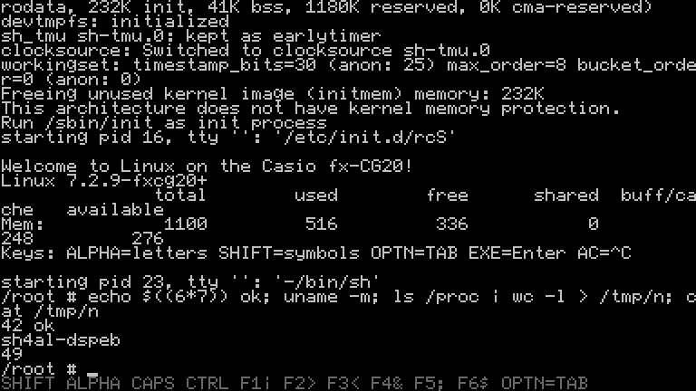

# fxcg20-linux-bundle

Builds Linux for the Casio fx-CG10 / fx-CG20 (Prizm): the toolchain, the
kernel with a BusyBox root file system, and the loader add-in.



## Files

| File | |
|---|---|
| `fxcglinux.g3a` | Loader add-in |
| `linux.bin` | Kernel, all in RAM |
| `linuxf.bin` | Kernel with part of its code in the flash (RAM part) |
| `flash.bin` | Flash part of `linuxf.bin` |

Copy them to the root of the storage memory and run **Linux** from the
main menu.

| Key | |
|---|---|
| F1 | Boot `linux.bin` |
| F2 | Boot `linuxf.bin`. If its flash part is not installed yet, `linux.bin` installs `flash.bin` first and resets; run Linux again. |
| F6 | Remove the flash part |
| EXE | F2 if available, otherwise F1 |

The flash part uses 0xc00000–0xc7ffff and 0xb20000–0xb3ffff of the NOR
flash. Linux uses all of the RAM: back up the Main Memory first. To go
back to the Casio OS, press RESET (or run `reboot`).

## Network over USB

On a USB cable the calculator is a network adapter for the computer
(CDC NCM). The computer gets 192.168.7.2 by DHCP; the calculator is
192.168.7.1:

```sh
telnet 192.168.7.1                          # a shell
curl http://192.168.7.1/etc/profile         # a file, or a directory listing
curl -T notes.txt http://192.168.7.1/tmp/   # send a file
```

The kernel has no networking: `ncmd` runs lwIP in user space on the
kernel's `/dev/ncm`.

## Sound

Tones come out of the 3-pin port (tip and sleeve), for instance with
`beep -f 440 -l 200`; the terminal bell beeps too.

## Building

Debian/Ubuntu:

```sh
sudo apt install build-essential bison flex bc texinfo libgmp-dev libmpfr-dev \
                 libmpc-dev libssl-dev libelf-dev cpio python3 git curl
scripts/build-toolchain.sh      # work/toolchain
scripts/build-usbnet.sh         # out/ncmd (and its test on this machine)
scripts/build-rootfs.sh         # out/busybox, out/initramfs.list
scripts/build-kernel.sh         # out/linux.bin
ROM=1 scripts/build-kernel.sh   # out/linuxf.bin, out/flash.bin
scripts/build-loader.sh         # out/fxcglinux.g3a
scripts/boot-test.sh            # boot test on the emulator (needs Go)
scripts/package.sh              # out/fxcg20-linux-<kernel>.zip
```

Sources and versions are in `scripts/versions.sh`. `KERNEL_SRC`,
`LOADER_SRC` and `EMU_SRC` select local trees.

`DEBUG=1` builds show the boot progress at the bottom right of the screen
and give a shell over USB (CDC ACM).

Copying files to the calculator over USB from Linux needs
`echo 4 > /sys/block/sdX/queue/max_sectors_kb`.

## Components

| | Repository | Branch |
|---|---|---|
| Kernel | [MaxSignal/linux](https://github.com/MaxSignal/linux) | `fxcg20-7.2.y` |
| Loader | [MaxSignal/fxcg-linux-loader](https://github.com/MaxSignal/fxcg-linux-loader) | `master` |
| Emulator | [MaxSignal/casio-cg50](https://github.com/MaxSignal/casio-cg50) | `linux-direct-boot` |

## Keys

The bottom line of the screen shows the modifiers.

| Key | Types | After SHIFT |
|---|---|---|
| digits, `.` `+` `-` `×` `÷` `(` `)` `,` | themselves (`×` is `*`, `÷` is `/`) | `+` `[`, `-` `]`, `×` `{`, `÷` `}`, `.` `=` |
| ×10ˣ | space | `"` |
| (−) | `_` | `%` |
| EXE / DEL / AC/ON | Enter / Backspace / Ctrl-C | – / Delete / sleep (AC/ON wakes up) |
| arrows | cursor keys | Home, PgUp, PgDn, End |
| F1–F6 | `\|` `>` `<` `&` `;` `$` | `~` `%` `` ` `` `'` `:` `"` |
| X,θ,T / log / ln / sin / cos / tan | `=` `'` `"` `#` `!` `?` | |
| a b/c / S⇔D / → / ^ | `:` `@` `\` `^` | `^`: `` ` `` |
| OPTN / VARS / EXIT | Tab / `~` / Esc | |
| **ALPHA** | next key types its red letter, lower case | |
| SHIFT, ALPHA | letter lock (ALPHA again to leave) | |
| x² | caps lock | |
| MENU | next key with Ctrl (MENU, ALPHA, D is Ctrl-D); MENU `+` / `-`: backlight | |

## Related work

- [gint](https://git.planet-casio.com/Lephenixnoir/gint)
- [casio-cg50](https://github.com/hexbinoct/casio-cg50)
- [linux-fx9750giii](https://github.com/cacioandpepe/linux-fx9750giii)
- [LinuX-CG50](https://github.com/Squaresweets/LinuX-CG50)
- [stm32h7-linux](https://github.com/rota1001/stm32h7-linux)
- [nspire-Linux-bundle](https://github.com/MaxSignal/nspire-Linux-bundle)

## Licence

GPL-2.0. lwIP, which the build downloads, has its own BSD licence.
